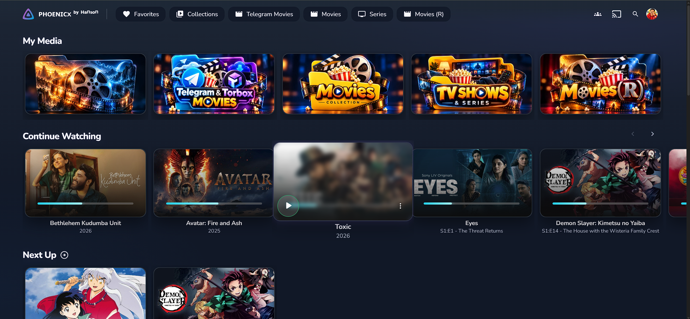

<div align="center">

# 馃幀 PHOENICX CINEMA
### Signature Edition 路 v2.0

**A cinematic, modern dark interface for Jellyfin.**

*Refined cards 路 Frosted glass 路 Lavender accents 路 Neon cyan playback progress 路 Media Bar styling*


**Your library. Your screen. Your cinema.**

</div>

---

## 鉁?Overview

**PHOENICX CINEMA** transforms the Jellyfin Web interface into a cinema-inspired experience with a dark layered background, rounded artwork, subtle hover animations, glass-like panels, lavender highlights, and luminous cyan playback indicators.

The current release is a **consolidated, standalone CSS theme**: it does not require separate ElegantFin or Media Bar *CSS imports*. It retains styling for a compatible Media Bar plugin, which must be installed and configured separately.

> [!IMPORTANT]
> Use **only one complete Jellyfin theme at a time**. Combining PHOENICX CINEMA with other full themes can cause layout and specificity conflicts.

## 馃柤锔?Preview

### Home screen



### 馃幀 Live theme preview

https://github.com/user-attachments/assets/d0ceab64-baa6-4925-b710-5c45a9956d99

> The preview reflects a particular Jellyfin setup. Media Bar content, artwork, and available controls depend on your installed plugins and library.

## 馃専 Features

| Feature | Current styling |
| --- | --- |
| 馃帪锔?Cinematic home screen | Layered dark gradients, backdrop treatments, and Media Bar slideshow support |
| 馃獰 Frosted glass | Translucent headers, drawers, dialogs, and panels with soft borders and shadows |
| 馃嵖 Movie and TV cards | Rounded artwork, responsive sizing, refined shadows, and hover transitions |
| 馃挏 Lavender accents | Focus states, highlights, navigation, and interface accents |
| 馃┑ Neon cyan progress | Glowing resume indicators and playback seek-bar highlights |
| 鈻讹笍 Playback controls | Rounded play buttons and consolidated control styling |
| 馃懁 Cast and actor pages | Dedicated actor-profile image styling |
| 馃敜 Typography | Nunito and Material Symbols with fallbacks |
| 馃摫 Responsive layouts | Desktop and mobile adjustments, plus TV-layout CSS rules where supported |
| 鈾?Motion and focus | Focus styling and reduced-motion media-query support |
| 馃摝 Consolidated CSS | A single combined stylesheet with no upstream theme CSS imports |

## 馃殌 Installation

Back up your existing Jellyfin **Custom CSS** before making changes.

### Option A 鈥?jsDelivr CDN

1. Sign in to Jellyfin as an administrator.
2. Open **Dashboard 鈫?General 鈫?Custom CSS** (location may vary by version).
3. Paste the following, **provided you have uploaded the current optimized file to your repository under this exact name**:

```css
@import url("https://cdn.jsdelivr.net/gh/hansonds/Phoenicx-Cinema-Theme@main/PHOENICX_CINEMA_v2_Optimized.css");
```

4. Save and refresh Jellyfin. A hard refresh (`Ctrl + Shift + R`) may help.

> [!NOTE]
> The CDN URL works only after the file is committed to the `main` branch with that exact filename. jsDelivr can cache branch-based assets, so updates may not appear immediately.

### Option B 鈥?Manual installation

1. Open [`PHOENICX_CINEMA_v2_Optimized.css`](PHOENICX_CINEMA_v2_Optimized.css) in this repository.
2. Select **Raw** and copy the complete stylesheet.
3. In Jellyfin, open **Dashboard 鈫?General 鈫?Custom CSS**.
4. Replace the previous theme CSS, save, and refresh.

Manual installation avoids the theme CDN dependency, but Google-hosted font assets still require network access.

## 馃帥锔?Customization

The consolidated theme uses core design variables. For example:

```css
:root {
    --accentColor: #a69cff;                /* Primary lavender accent */
    --accentHoverColor: #cbc4ff;           /* Brighter hover accent */
    --textColor: #f7f7fc;                  /* Primary text */
    --dimTextColor: #aab0c1;               /* Secondary text */
    --cardResumeProgressColor: #67e8f9;    /* Resume progress accent */
    --osdSeekBarPlayedColor: #67e8f9;      /* Playback progress accent */
    --px-card-radius: 15px;                /* Card corners */
    --px-panel-radius: 20px;               /* Panel corners */
    --px-glass-border: rgba(255,255,255,.11);
}
```

**CDN users:** Put custom overrides *after* the import:

```css
@import url("https://cdn.jsdelivr.net/gh/hansonds/Phoenicx-Cinema-Theme@main/PHOENICX_CINEMA_v2_Optimized.css");

:root {
    --accentColor: #a69cff;
    --accentHoverColor: #cbc4ff;
}
```

> [!NOTE]
> Some effects (including the cyan progress gradients and glow) also use direct CSS color values. Changing a variable alone may not recolor every element. The example above lists variables actually present in the consolidated stylesheet.

## 馃З Compatibility

- **Jellyfin Web:** Intended for modern Jellyfin Web interfaces, including Jellyfin 12-related styling.
- **Media Bar:** Requires a separately installed and compatible Media Bar plugin for slideshow functionality.
- **Desktop browsers:** Modern Chromium-based browsers are a useful baseline; other browser engines may render effects differently.
- **Jellyfin desktop clients:** Styling applies only when the client uses and accepts the server's web CSS.
- **Mobile and TV apps:** Native clients may ignore Jellyfin Web custom CSS entirely.
- **Fonts:** Google-hosted fonts and icons may fall back when unavailable.

Compatibility and visual consistency are not guaranteed across all Jellyfin versions, plugins, or devices.

## 馃洜锔?Troubleshooting

| Issue | What to try |
| --- | --- |
| Old theme still appears | Hard-refresh, clear cached assets, and check the Custom CSS field |
| CDN theme does not load | Verify the repository, branch, and filename; test the stylesheet URL directly |
| Layout or controls look wrong | Remove competing full themes and retest |
| Media Bar is missing | Confirm plugin installation, configuration, and Jellyfin compatibility |
| Font or icons look different | Check access to Google font resources |
| Mobile or TV looks different | Check whether that client supports Jellyfin Web custom CSS |
| Colors do not fully change | Inspect component-specific declarations and hard-coded gradients |

To revert, remove the theme import or pasted CSS, restore your backup, save, and refresh.

## 馃搧 Repository structure

```text
Phoenicx-Cinema-Theme/
鈹溾攢鈹€ README.md
鈹溾攢鈹€ PHOENICX_CINEMA_v2_Optimized.css
鈹溾攢鈹€ PHOENICX_CINEMA_THIRD_PARTY_NOTICES.txt
鈹斺攢鈹€ Screenshots/
    鈹斺攢鈹€ home.png
```

> Update the repository paths above if you choose different filenames or capitalization. GitHub file paths are case-sensitive.

## 馃檶 Credits and third-party notices

PHOENICX CINEMA incorporates and adapts styling from third-party Jellyfin projects, including:

- **[ElegantFin](https://github.com/lscambo13/ElegantFin)** by **lscambo13**
- **ElegantFin Media Bar Plugin Support** by **lscambo13**
- **[ElegantFin for Jellyfin 12 Modern](https://github.com/mihaif7/elegantfin-jf12)** by **mihaif7**

See [`PHOENICX_CINEMA_THIRD_PARTY_NOTICES.txt`](PHOENICX_CINEMA_THIRD_PARTY_NOTICES.txt) for attribution and licensing information. Original authors retain their rights; comply with the applicable upstream licenses when redistributing the combined stylesheet.

---

<div align="center">

### 馃挏 PHOENICX CINEMA

**Your library. Your screen. Your cinema.**

*Built for a more immersive Jellyfin experience.*

</div>
